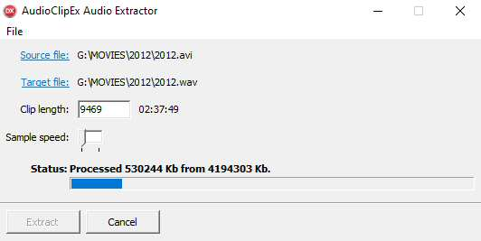

# About MfPack
  
 Deelphi to Free Pascal port for Microsoft Media Foundation and related API's.
  
# MfPack covers the following API's:
  
- Core Audio API's:
  * Windows Audio Session API (WASAPI) 
  * DeviceTopology API
  * EndpointVolume API
  * Multimedia Device (MMDevice) API
- Microsoft Media Foundation API (successor of DirectShow).
- XAudio2 API (XBox game development, successor of DirectSound).
- Microsoft DirectX API's (D2D1, D3D9, D3D11, D3D12, DirectComposition, DXGI,  
  DirectWrite and DXVA) Note that D3D11 and above are part of Media Foundation.
- Windows Imaging Component (WIC) API.
- MPEG2 API.
- The complete Windows Media (WinMM) API.
  
# MfPack API's and Samples
  
- MfPack Cast V2.2 API.
- MfPack FxServe V1.1 API.
- Media Foundation, WASAPI, XAudio2 and streaming samples.
  
  
# <u>Latest release:</u> 
  
# MfPack Version 4.1.0  
FPC/Lazarus version 3.2.2  
SDK version: 10.0.28000.2705 (Windows 11).  
  
  
  
**Important note:**  
The latest Windows 11 versions do not support Dolby AC-3 and H.265 (hvec) encoders.  
Those you can buy from Microsoft Store or download elsewhere.
  
  
---
  
# Updates and porting status
### The porting of the complete MfPack Windows API sources (src) and Tools has been completed.  
### Porting the samples, Cast, and FxServe are still in progress, these and updates will be published as soon as possible.
  
---
  
# Samples
  
  
**AudioClip sample**
  
Demonstrates using the IMFSourceReader API to extract uncompressed media data from  
a media file. This sample application reads audio data from a media file and writes  
the uncompressed audio to a WAVE file.
  

  
---
  
# Tools
  
**HResult Lookup Tool Application**
  
This tool can be used to determine HResult or Error codes returned by the Windows OS,  
featuring a detailed build in "HResult Lookup tool", the "Windows System Error Code Lookup Tool" and  
the "System.SysUtils.SysErrorMessage" function, that provides the localized translation (language of your OS) of the HResult.  
  

  
  
**Copyright © FactoryX. All rights reserved.**
