# About MfPack-FPC
  
MfPack-FPC is a Delphi port to Free Pascal/Lazarus for Microsoft Media Foundation and related API's.
  
# MfPack-FPC covers the following API's:
  
- Core Audio API's:
  * Windows Audio Session API (WASAPI) 
  * DeviceTopology API
  * EndpointVolume API
  * Multimedia Device (MMDevice) API
- Microsoft Media Foundation API (successor of DirectShow).
- XAudio2 API (XBox game development, successor of DirectSound).
- Microsoft DirectX API's (D2D1, D3D9, D3D11, D3D12, DirectComposition, DXGI,  
  DirectWrite and DXVA) Note that D3D11 and above are part of Media Foundation.
- Windows Imaging Component (WIC) API.
- MPEG2 API.
- The complete Windows Media (WinMM) API.
  
# MfPack-FPC API's and Samples
  
- MfPack Cast V2.2 API.
- MfPack FxServe V1.1 API.
- MfPack HEOS.
- Media Foundation, WASAPI, XAudio2 and streaming samples.
  
  
# <u>Latest release:</u> 
  
# MfPack Version 4.1.0  
FPC/Lazarus version 3.2.2 (64 bit)  
SDK version: 10.0.28000.2705 (Windows 11).  
  
  
  
**Important note:**  
The latest Windows 11 versions do not support Dolby AC-3 and H.265 (hvec) encoders.  
Those you can buy from Microsoft Store or download elsewhere.
  
  
---
  
# Updates and porting status
### The complete port of MfPack to FPC / Lazarus is ready!
  
---
  
# Samples
  
  
**AudioClip, AudioClipEx and AudioClipEx2 samples**
  
Demonstrates using the IMFSourceReader API to extract uncompressed media data from  
a media file. This sample application reads audio data from a media file and writes  
the uncompressed audio to a WAVE file.  
The AudioClipEx sample demonstrates using the IMFSourceReader and 
IMFSourceReaderCallback API to extract uncompressed audiodata from a media file.  
  
The AudioClipEx2 sample demonstrates using the IMFSourceReader,  
IMFSourceReaderCallback and IMFSinkWriter API to extract uncompressed audiodata from a  
media file and write the audio to a wav. It also uses threads for better responsiveness.
  

---  
## SimpleVolumeControl sample
  
This example shows how to use the MfAudioEndPoint component.  
Note that the maximum value of the maximum static DB values () are arbitrary!  
Please, install the '..\Samples\Components' first before loading this project.
  
---
## MfPlayer samples

The player samples are based on the original Microsoft CPlayer sample.  
There are 4 samples in 4 project degrees.  
  
- *MfPlayer I : The basic player sample.*
- *MfPlayer II : The extended version I sample.*
- *MfPlayer X : This is an example that shows how to use the IMFTimer, language tags,*  
  *subtitles (SubRip, MicroDvd and WebVTT), RegEx (Regular Expressions) and how to get media properties.*
- *MfPlayer X2 : This example is based on the MfPlayer X project, but replaces the floating*
  *subtitle overlay with a real video-frame subtitle pipeline.*
  *Subtitles are now injected into the decoded video for local playback.*
  *Added MP4 export and Chromecast/Android TV/Google TV streaming support.*
  *The Player also demonstrates how Media Foundation playback, timed text,*
  *MFT processing, Source Reader/Sink Writer transcoding, IMFByteStream,*
  *mDNS, TLS, MfPack Cast V2 messages, and a local HTTP server can work together*
  *inside a FPC/Lazarus application, without using 3th party components.*
  

---
  
## MediaEngine player samples

**MfMediaEngine Player 1**

This is the basic class of MfMediaEnginePlayer, containing the necessary methodes to play a mediafile.  

For indepth information see the Microsoft MediaEnginePlayer example and documentation, containing the complete information about MfMediaEnginePlayer. 
  
---
  
**MfMediaEngine Player 2 & IMFTimedText sample**
  
MediaEngine player (IMFMediaEngine(Ex)) with support for subtitles (closed captions) using  
the IMFTimedTextNotify interface.
  

  
For indepth information see the Microsoft MediaEnginePlayer example and documentation, containing the complete information about MfMediaEnginePlayer. 

---
  
## MfSimpleCapture Sample

This example shows, how you have to implement capturing within a session.  
Note: The old MS sample used the deprecated IMFplayer interface. 
  

---
  
## MfVideoThumbNails sample
  
Demonstrates how to use the source reader to get video thumbnail images.  
For indepth information see the [VideoThumbNails example and documentation.](https://learn.microsoft.com/en-us/windows/win32/medfound/videothumbnail-sample)
  
*This sample app needs the D2D1 Api. If your Delphi version doesn't have the  
D2D1 API, May 2019 update or later, use the D2D1 MfPack version.*

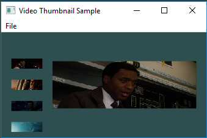
  
---
  
## MfTranscode samples
  
Demonstrates using the transcode API to transcode a source file (audio or video) to  
a different format (audio or video) supported by Media Foundation.  
  
Supported, but not limited, formats in this sample are:
  
- Audio
   * Waveform Audio File Format (wav)
   * MPEG Audio Layer III (mp3)
   * Free Lossless Audio Codec (flac)
   * MPEG-4 Audio (m4a)
   * Windows Media Audio (wma)
  
- Video
   * Audio Video Interleave (avi)
   * MPEG-4 Video with AAC Audio (mp4)
   * MPEG-4 Video with Dolby AC-3 Audio (mp4) 
   * Windows Media Video (wmv)

  
---
  
## CaptureEngineVideoCapture Samples

**CaptureEngineVideoCapture Sample**  
  
Demonstrates how to capture a snapshot or a recording (A-synchronous) from a capture device,  
such as a webcam using the IMFCaptureEngine and IMFCapturePreviewSink.  
This sample also demonstrates how to use the MfMediaTypeDebug API.  
  
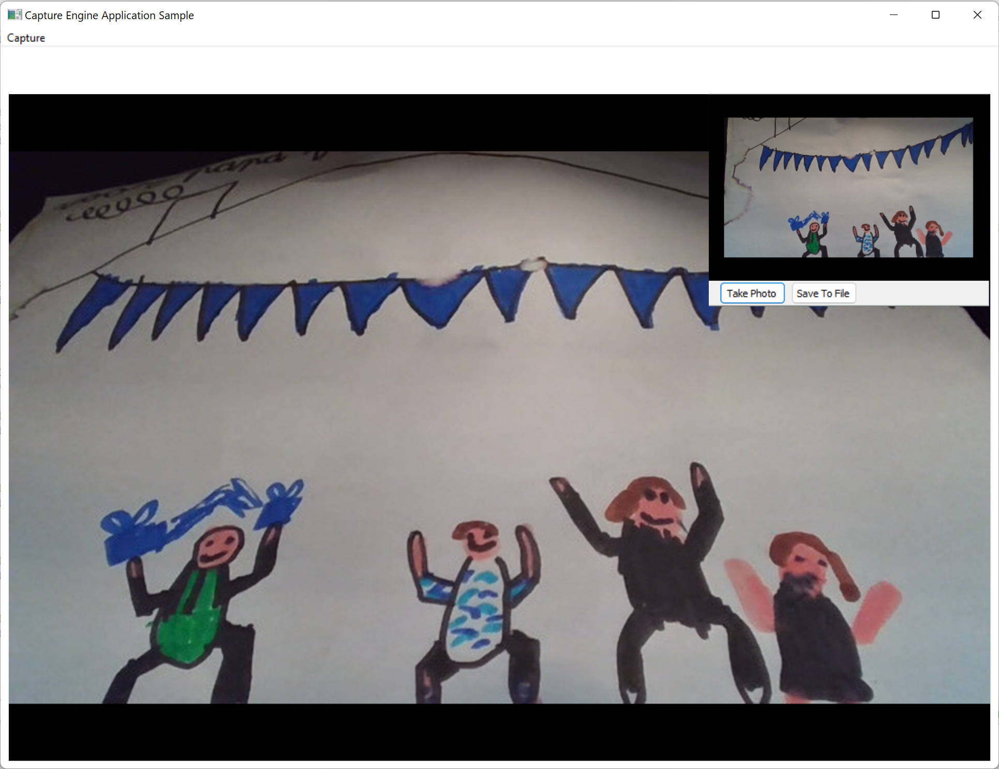
  
---
**CaptureEngineVideoCapture Sample 2** 
  
This is an extension of the CaptureEngineVideoCapture Sample.  
The sample is extended with camera and video setting options, including rotation.
  
---
## MfWebCamStreamer Sample
  
This sample is the extended version of MfSimpleWebCamStreamer, that uses FxServe to  
stream over the internet. Within the browser or installable PWA,  
users can watch the video and are able to take snapshots or record the camera stream. 
Note: The PWA operates like an app, that can be installed via the Install button in the browser.  
There is no need to get the PWA from any "Store".
  
The browser player includes:
  
- A live elapsed timer;
- PNG snapshots of the current camera frame;
- Client-side recording through `MediaRecorder` (downloaded as WebM);
- Live viewer count with privacy-masked IP addresses;
- Sound, playback, reconnect, and live-edge controls.
  
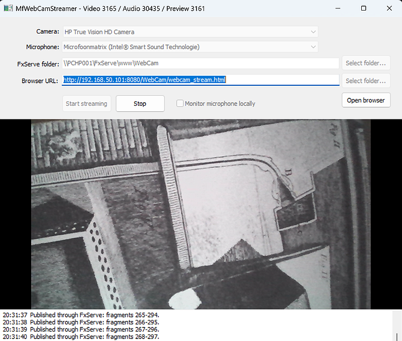

---
## MfComponents Samples

This package contains the following -installable- components:  
  
* TQTimer - Queue Timer component. For precise timing.
* MfAudioEndPoint - Audio EndPoint component that responds to volume changes.
  Uses: IAudioEndpointVolumeEx, IAudioEndpointVolumeCallback and IMMDeviceEnumerator.
* TThreadedQTimer - A threaded queue timer (experimental)

**Visual controls**

**MfPeakMeter, MfPeakMeterEx MfPeakMeterMmcs component samples**
  
An example about how to create a MfPeakMeter control. This sample is part of the  
Samples/MfComponents package.  
  

  
An example about how to create a MfAudioVisualizer control - A visual component that  
uses  loopback, Peak/RMS, optional spectrum bars or VU.  
This sample is part of the Samples/MfComponents package.  

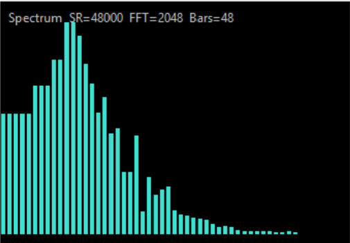
  
**WASAPI player / dsp / mft components:**
  
* MfWasApiPlayerEngineComponent - WasApi renderer component supporting the MfWasApiEffectsRack and effects.
* MfParametricEqComponent - Parametric equalizer component.
* MfFlangerEchoComponent - Flanger / Echo component.
* MfCompressorLimiterComponent - Compressor / Limiter component.
* MfPitchTempoComponent - Pitching / tempo component.
* MfChorusComponent - Chorus component.
* MfWasApiEffectsRack - Effects rack component that controls FX DSP's and MFT's.
  
Note: On how to use these components, please read the WasApiPlayer sample 5 documentation.
  
# Other files/ helpers for the components.
* PcmLib.pas - A very convenient unit that is capable of recoding diverse WAV formats.
* WASAPIEngine.pas - Universal WASAPIEngine .
  
---
  
## WASAPI Player samples
  
**Player Sample 1**
  
This sample demonstrates how to use the IAudioClient to render different  
audio formats like WAV, FLAC, MP3 etc.  
using the IMFSourceReader to decode the format suitable for playing in  
's IAudioClient and renderer.  
  
The sample plays formats like WAV (pcm and floatingpoint), MP3 and FLAC.  
It shows you the basics of using the IAudioClient, iAudioRenderer,  
IAudioClock and IAudioStreamVolume interfaces.  
The sample uses the MfPeakMeter component. This requires that you install the MfComponents.  
In your projectsettings you have to add ..MfPack\Samples\MfComponents in the project options searchpath.  
  
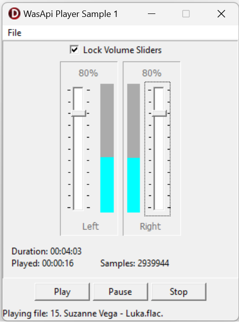
  
---
  
**Player Sample 2**
  
This sample is based on Sample 1, but includes full threaded code,  
using threadsafe events and also uses a custom MFT for bass and treble control.  
  
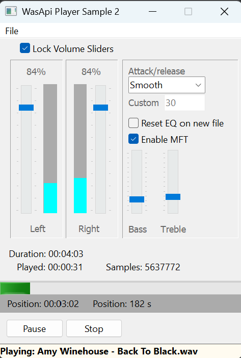
  
---
  
**Player Sample 3**
  
This sample is based on Sample 2, instead of a bass/treble MFT, this one is equiped with  
a 3 band High, Mid(Peaking or Notch) and Low EQ MFT and a spectrum analizer.  
It also stores and read back settings for the MFT.  
  
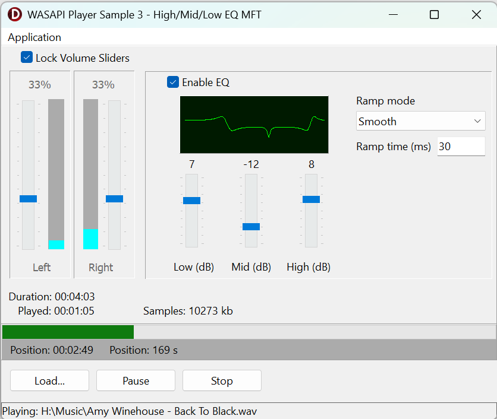
  
---
  
**Player Sample 4**
  
This sample demonstrates a **real-time audio playback engine on Windows** using:
  
- **** (event-driven, shared mode).
- **Media Foundation SourceReader**.
- A custom **3-band EQ** implemented as an **IMFTransform (MFT)**.
- A **Compressor / Limiter DSP**.
- Thread-safe **GUI and engine** command routing.
- The EQ settings are stored in an **INI file**.
  
**Features**
  
- Glitch-free real-time playback.
- Low / Mid / High EQ with live control.
- Mid band supports **Peaking** or **Notch** mode.
- Adjustable **Q (bandwidth)** and shelf slopes.
- Settings dialog with persistent storage.
- Compressor / Limiter DSP with live control from the settings menu.
  
**Note:**  
This is not a sample for absolute beginners. Please read the documents included with this sample.  
  

  
---
  
** Player Sample 5**
  
This is a non-visual components application sample using .  
The sample shows you how to build a real-time audio playback engine for Windows using FPC/Lazarus style components.  
  
## Features  
This sample also demonstrates how to create and implement a:
  
- Compressor/Limiter component using a MFT.
- Parametric Equalizer component using a MFT.
- Flanger/Echo component using a MFT.
- WASAPI effects rack that connects al MFT components to the WASAPI renderer.
- PlayerEngine component, using a WASAPI renderer.
  
**Note:**  
This is not a sample for absolute beginners.  
Please read the documents included with this sample.  
  
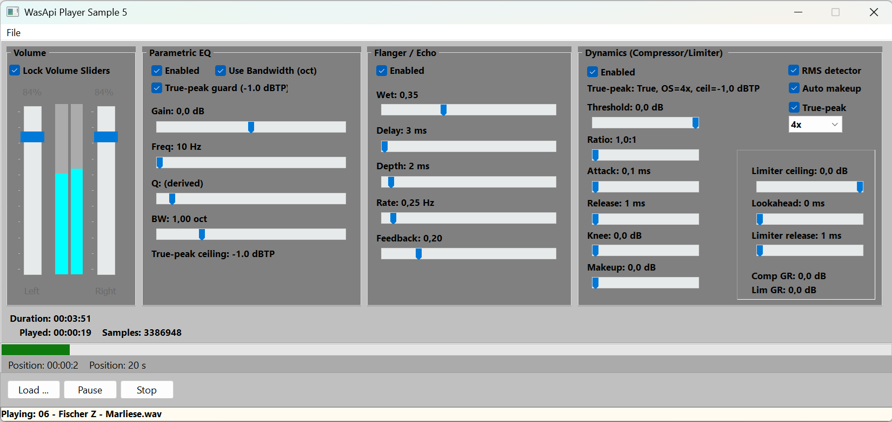
  
---
  
## MfProtectedPlayback
  
This sample demonstrates playback of clear and protected media with  
Microsoft Media Foundation and the Protected Media Path (PMP). It is a close  
Delphi translation of Microsoft's `ProtectedPlayback` C++ sample and uses the  
Media Foundation declarations supplied by MfPack.  
  
The translation of this Microsoft sample preserves the structure, class names, method names, and
control flow of the original sample wherever Delphi permits them. 
The sample includes the original C++ code for references.  

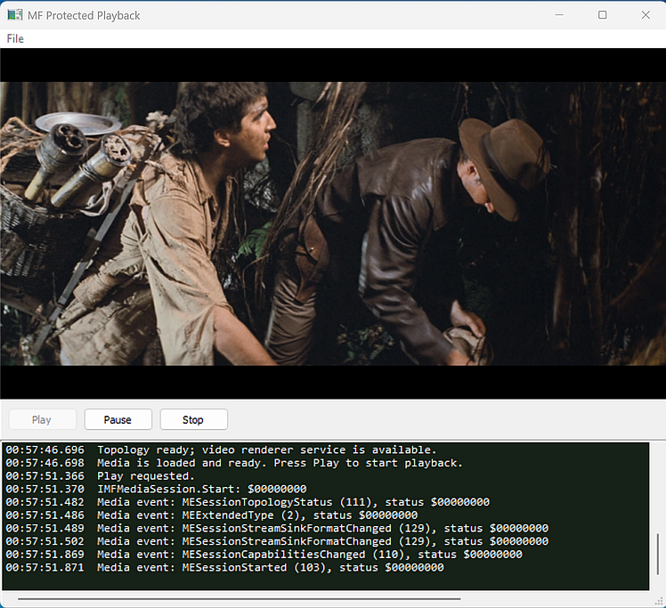

---

## Ducking samples
  
**Ducking Media Player**
  
This sample implements a simple media player that responds to the "ducking"  
feature in Windows 7 and later. It also implements a volume control which tracks  
to the volume control in the volume mixer.  
  
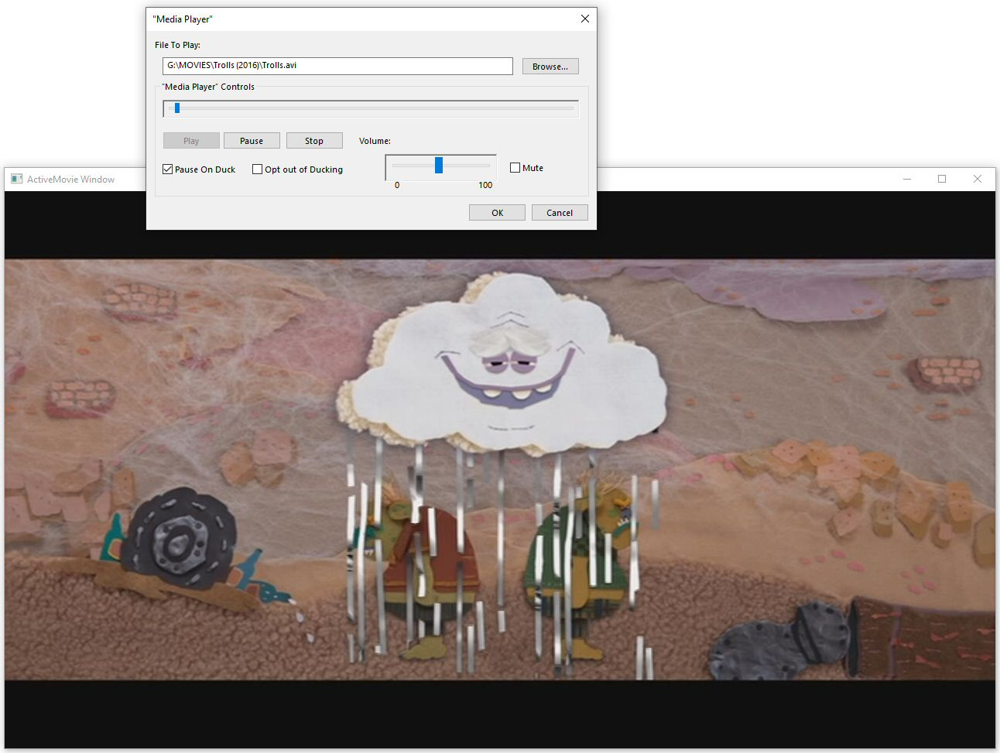
  
---
  
**Ducking Capture Sample**
  
This sample implements a simple "Chat" that demonstrates the Windows audio  
ducking feature. In capture mode, audio from the default communications  
capture endpoint is routed to the default playback endpoint.  
Select 'Use default input device' in the application to hear the routed input.  
  

  
---
  
## Webcam streamer samples
  
**MfSimpleWebCamStreamer**
  
This sample demonstrates how to capture from a webcam and  
microphone with Microsoft Media Foundation, encoding the result as H.264  
and AAC, and publishing the live stream directly to a web browser through  
fragmented MP4 and Media Source Extensions (MSE).  
It demonstrates the complete path from Media Foundation capture to a  
browser-playable live stream without requiring another external  
media server on a local network.

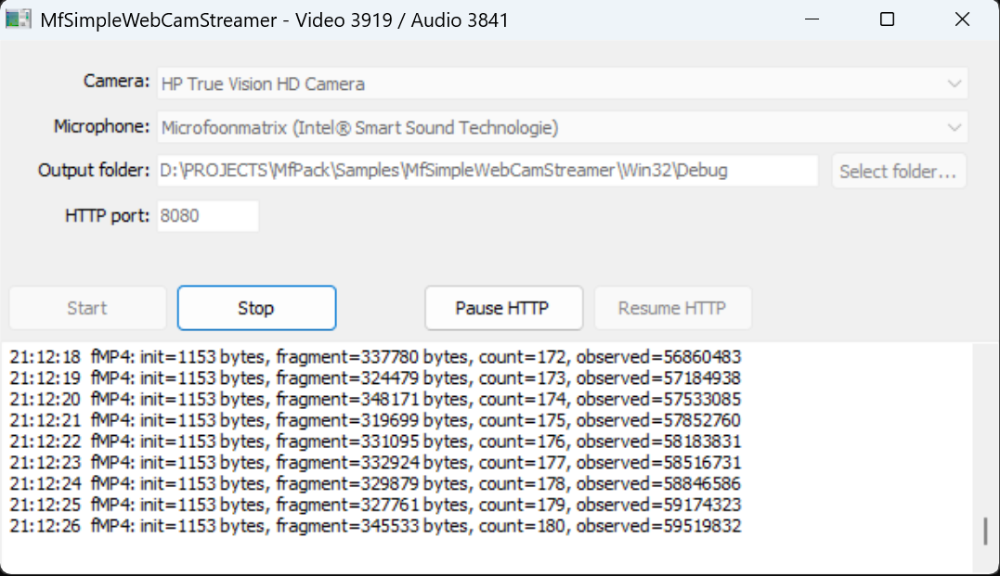
  
---
  
**MfWebCamStreamer**
  
This sample is the extended version of MfSimpleWebCamStreamer, that uses FxServe to  
stream over the internet. Within the browser or installable PWA,  
users can watch the video and are able to take snapshots or record the camera stream. 
Note: The PWA operates like an app, that can be installed via the Install button in the browser.  
There is no need to get the PWA from any "Store".
  
The browser player includes:
  
- A live elapsed timer;
- PNG snapshots of the current camera frame;
- Client-side recording through `MediaRecorder` (downloaded as WebM);
- Live viewer count with privacy-masked IP addresses;
- Sound, playback, reconnect, and live-edge controls.
  

  
---
  
## MfCastPlayer Samples
  
**MfSimpleCastPlayer Sample**
  
**This sample demonstrates:**
  
- Asynchronous Chromecast discovery.
- Device selection.
- Casting a compatible local file through a built-in HTTP server.
- Casting a directly reachable HTTP/HTTPS media URL.
- Play, pause, stop, seek, volume, mute, and disconnect.
- External subtitle files and embedded text-subtitle enumeration. External subtitle  
  files are preferred when the same language exists in both sources.
- Exact embedded-track selection and subtitle switching while casting.
  
The sample enables the optional Media Foundation conversion stack. Compatible  
MP4/H.264/AAC, WebM, MP3, M4A, and AAC sources use direct play. Containers such  
as MKV are converted to fragmented MP4 and published by the build-in HTTP server.  
Please read the white paper document MfPack/Cast/MfPack_Chromecast_API_White_Paper.txt for  
full details using the MfPack Cast API.  
  

  
---

**MfCastPlayer Sample**
  
This it the extended version of MfSimpleCastPlayer.  
  
**This sample demonstrates the following additions of MfSimpleCastPlayer:**
  
- Casting a YouTube URL through an application-provided
  `IMfCastSourceResolver` implementation;
- A fast YouTube mode that resolves a combined H.264/AAC stream for direct
  playback;
- A best-quality YouTube mode that downloads separate video and audio streams
  and merges them into an MP4 file;
- Local video and audio preview through the `TMfCast` main interface;
- Audio-only playback with optional JPG, PNG, BMP, or GIF artwork;
- Heartbeat monitoring and automatic cleanup when the receiver is switched
  off or stops responding.
  
The sample enables the optional Media Foundation conversion stack.  
Compatible MP4/H.264/AAC, WebM, MP3, M4A, AAC, FLAC, WAV, and Ogg sources can use direct  
playback. Other containers and codecs, including AVI and MKV when required,  
are remuxed or converted to fragmented MP4 and published by the local HTTP  
server.  
  
Please read `MfPack/Cast/MfPack_Chromecast_API_White_Paper.txt` for full details  
about using the MfPack Cast API.  
  
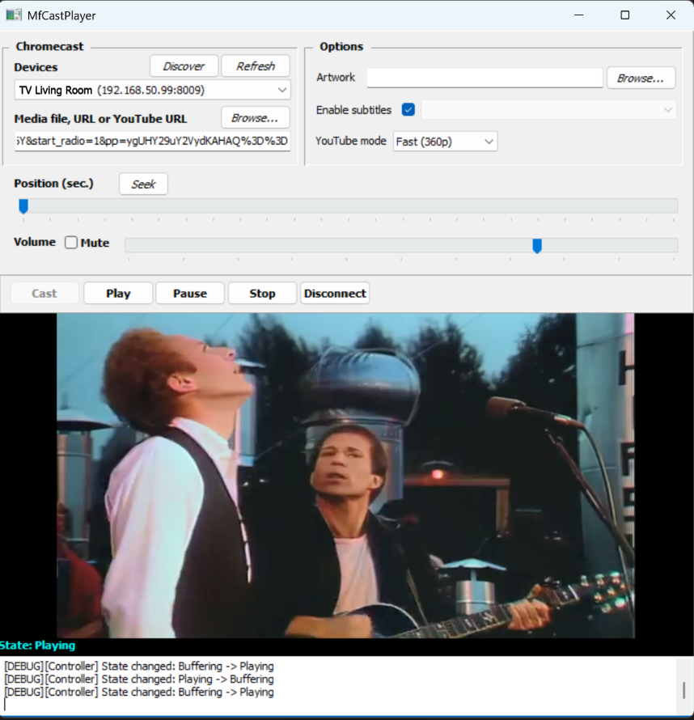
  
---

**MfCastPlayer Sample II**
  
This is the alternative version of MfCastPlayer.  
  
**This sample demonstrates the following differences of MfCastPlayer:**  
  
The sample uses DXGI desktop duplication to make it possible casting from for example a browser or other player content.  
It avoids installing 3th party apps viewing web content like YouTube.  
There is some trade off: The quality of origin is downgraded to the monitor resolution it play's on.
    
---
  
## CameraFrameCapture Sample
  
Demonstrates how to capture a still image or so called snapshot (A-synchronous) from a    
capture device such as a webcam or camera using the IMFSourceReader.
  
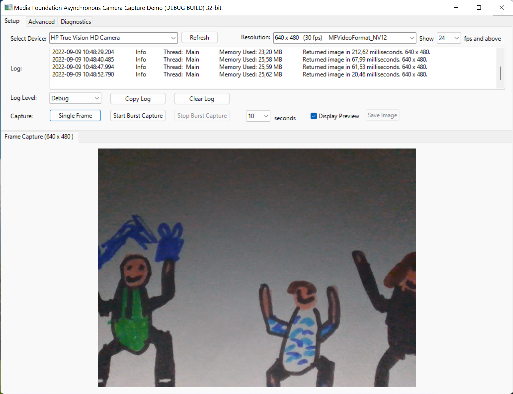
  
---
  
## CaptureEngineVideoCapture sample
  
Demonstrates how to capture a snapshot or a recording (A-synchronous) from a capture device,  
such as a webcam using the IMFCaptureEngine and IMFCapturePreviewSink.  
This sample also demonstrates how to use the MfMediaTypeDebug API.  
  

  
---
    
## SinkWriterToEncodeVideo Samples

*Example 1*  
This sample creates a simple green bitmap (640x480) and stores it to a file with a length of 20 seconds.  
  
*Example 2*  
Demonstrates how to use the SinkWriter to create a video from one or more bitmap files.  
  
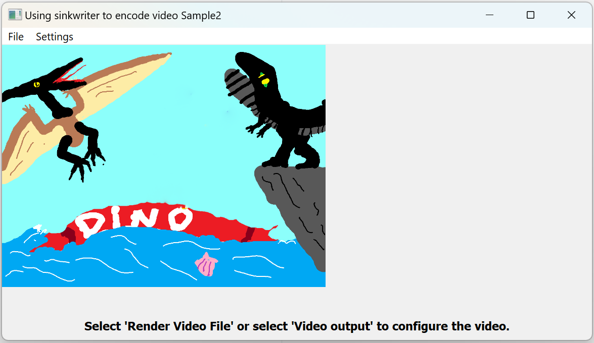
  
*Example 3*  
Demonstrates how to use the SinkWriter to create a video from one or more image files including audio.
  
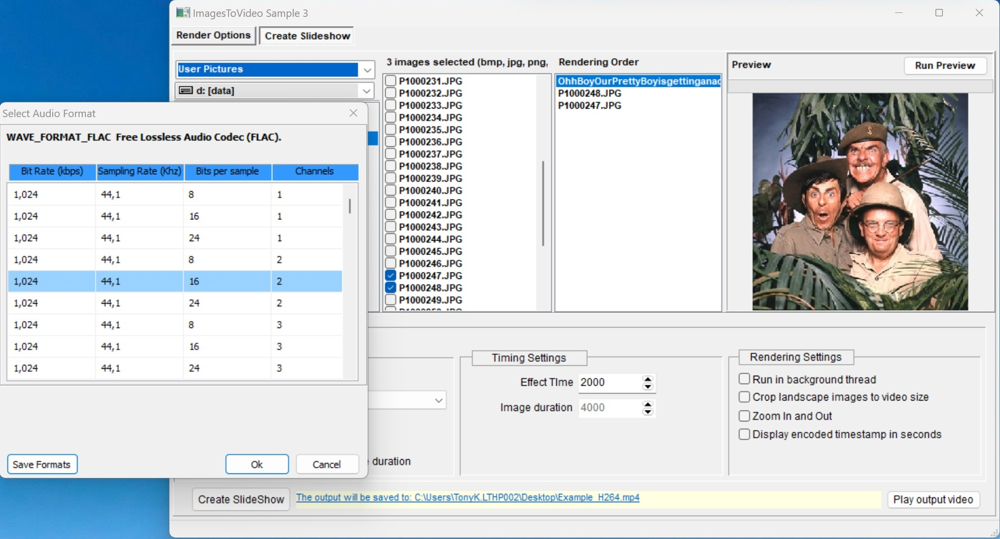
  
---

---
  
## LoopBackCapture Samples
  
**LoopBackCapture Sample 1**
  
Demonstrates how to capture sound from the default rendering device (soundcard) using WASAPI in combination with mmio to write wav-files.  
Note that mmioOpen() is deprecated as mentioned in the documents, but this seems to be a bug in the documentation since Windows Vista.  
The sample difference from the original sample where the audioclient buffersize is fixed that leads to an oversized buffer on modern audio devices.  
This sample lets you to choose between different latency's for better sound to eliminate buffer related gliches.  
  
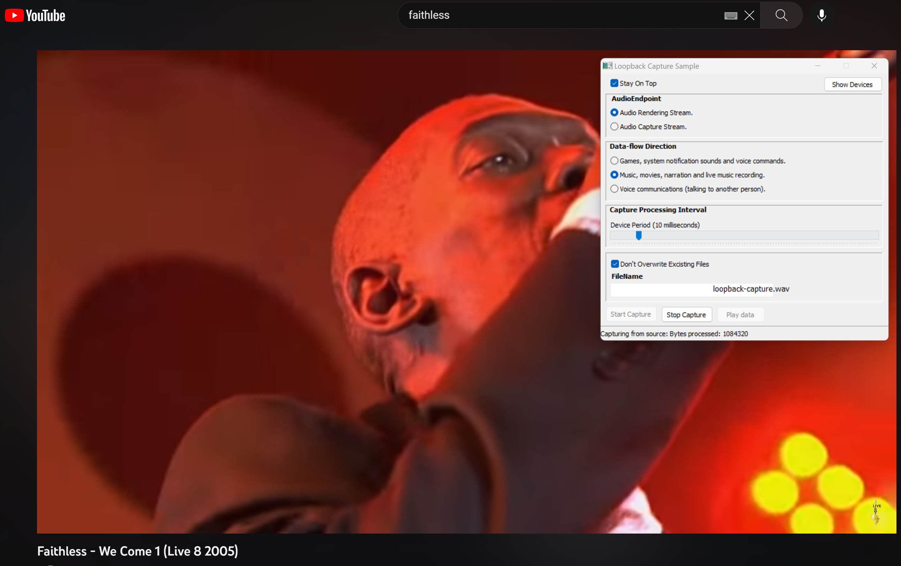
  
---
  
**LoopBackCapture Sample 2**
  
This sample demonstrates how to capture system audio either from a  
specific process tree or for all process except  
a process tree and the use of ActivateAudioInterfaceAsync Win32 API  
with a new initialization structure.  
The new data structure makes it possible to restrict captured  
audio data to that rendered by a specific process and any of its child processes.  
Windows 10 has always supported capturing all audio that is played on  
an audio endpoint (referred to as "system" loopback capture),  
which captures all audio from all apps that are playing sounds on  
the chosen audio endpoint.  
  
With the new structure, only audio from the specified process,  
and its children, will be captured. Audio rendered by other processes will not be captured.  
A flag is also provided to reverse the behavior, capturing all system  
audio *except* those from the the specified process (and its children).  
Furthermore, the capture is not tied to a specific audio endpoint,  
eliminating the need to create a separate IAudioClient to capture from each physical  
audio endpoint.  
  
If the processes whose audio will be captured does not have any audio rendering streams,  
then the capturing process receives silence.  
  
It also demonstrates how to get a process by using the tlhelp32 API,  
to list a snapshot of running processes and be able to pick one.  
The application is provided with a dialog to select a running process from  
the process tree you want to pick and has a button to get the current PID of your application.  
  
The application is using MMCSS and runs the rendering part in a separate thread.  
  
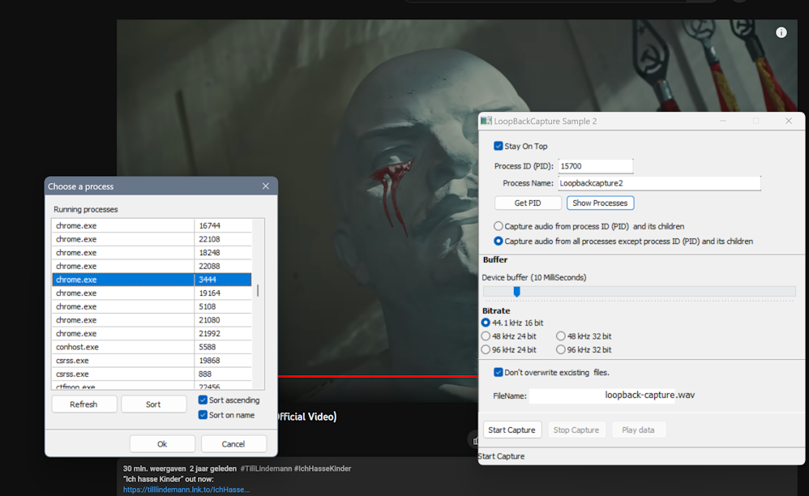
  
---
  
**Threaded Loopback Capture Sample**
  
Demonstrates how to capture sound from a rendering or capture device (one of the soundcard's endpoints) using  in combination with mmio to write wav-files.  
This sample lets you to choose between different latency's and buffersize for better sound to eliminate buffer related gliches.  
  
*It has some more advanced features like:*  
   - *The rendering part is running in a separate thread to eliminate glitches.*
   - *Able to use MMCSS (Multimedia Class Scheduler service).*
   - *Stream switch detection.*
   - *Possibility to write wav data in native format 44.1 kHz/ 16 bit PCM or* 
     *the soundcard's audio format (including Uncompressed IEEE floating-point audio).*
  
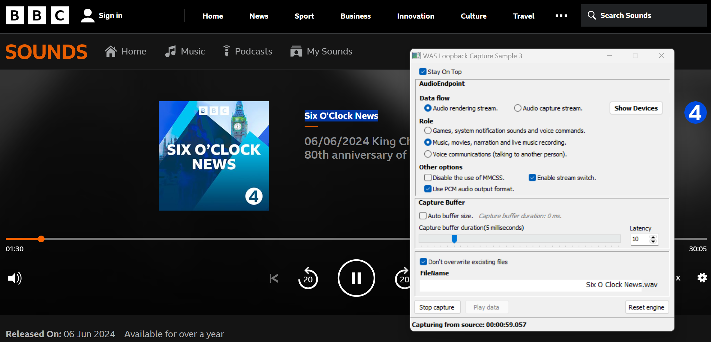
  
---
  
## MfCaptureVideoFromGPU Samples
  
**MfCaptureVideoFromGPU Sample 1**
  
This sample demonstrates how to capture from screen using your videocard GPU.  
  
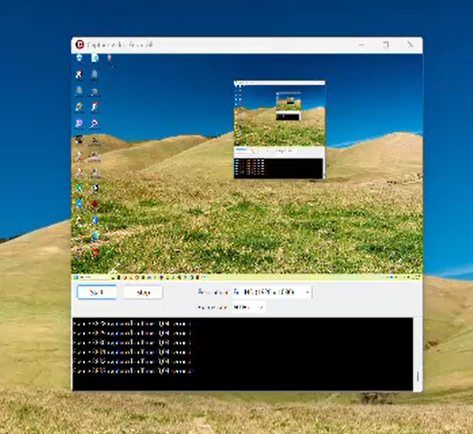
  
---
  
**MfCaptureVideoFromGPU Sample 2**
  
This sample demonstrates how to capture a selected monitor (screen)  
connected with the graphics card GPU using DXGI Desktop Duplication,  
optionally captures system audio via WASAPI loopback, shows a live preview,  
and writes the result to a file (typically MP4 with H.264 video and AAC or FLAC audio).  
  
Audio-only recording can be done separately to WAV or FLAC using the  
dedicated recorder unit.  
  
**Note:**  
You need good knowledge of Media Foundation, DirectX and GPU processing.  
  
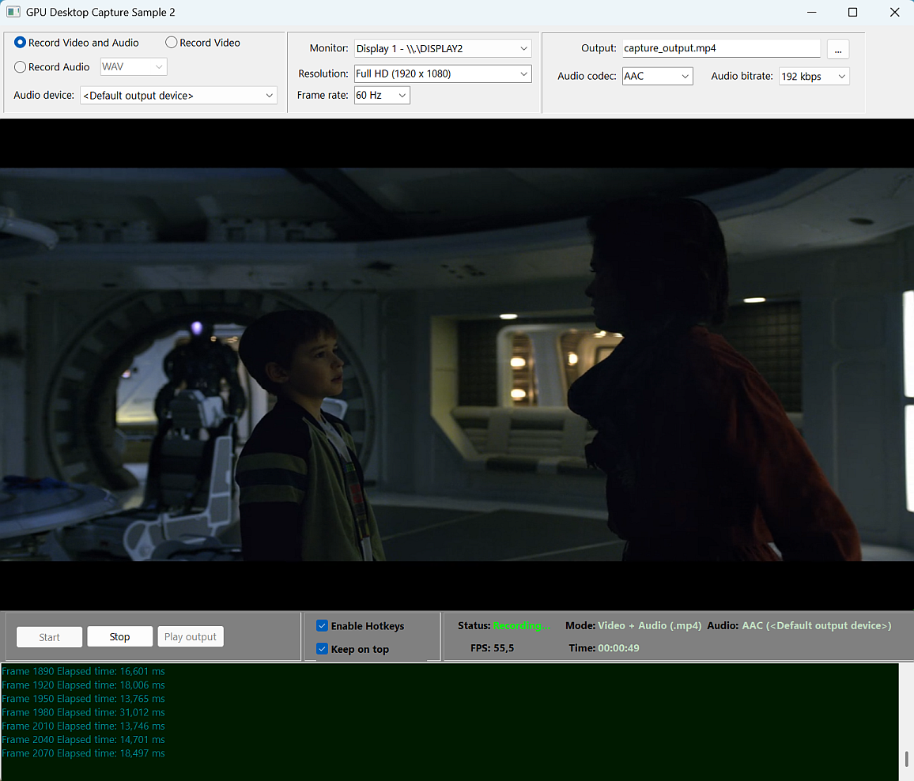
  
---

# MfRDJ Samples

MfRDJ and MfRDJ Pro are FPC projects containing source code and binaries.
The minimum supported compiler is FPC 3.2.2 / Lazarus 4.8.

**MfRDJ**  

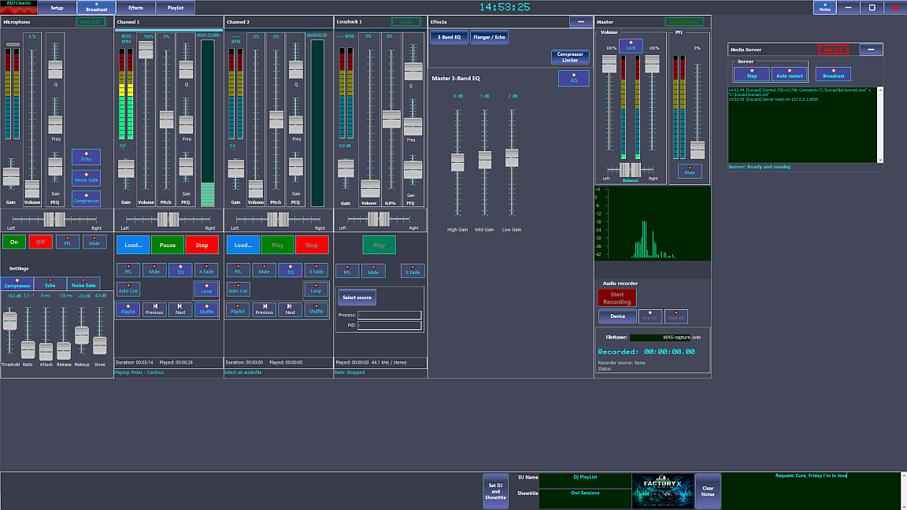
  
This application is a multi-channel audio mixer with effects.  
The Mixer is fully adjustable for audio endpoint assignments, mixer decks and loopback decks.
This mixer is primarily intended for live music, but it's capable of internet broadcasting with Caddy/IceCast.

**Important note:**  
Before opening the project in the IDE, make sure you have all needed components installed (see instructions).
  
  
  
**MfRDJ Pro** 
MfRDJPro is the extended version of MfRDJ.  
  
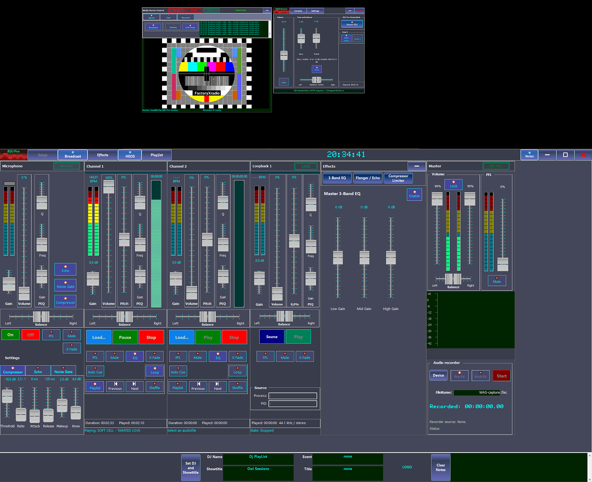
  
Where MfRDJ mainly demonstrates DJ-style audio playback and mixing with MfPack,  
MfRDJ Pro adds a complete live broadcast layer around the mixer.  
MfRDJ Pro still provides the familiar RDJ functions: channel decks,  
loopback decks, microphone input, effects, PFL/cue monitoring, playlist editing,  
tag editing, and local recording.

The Pro version expands this into an audio/video streaming application.  
It can combine the live program audio with camera video or a static video source,  
encode the result with Microsoft Media Foundation, and publish it as a browser-playable stream.

The main technical difference is the broadcast pipeline.  
MfRDJ Pro uses Media Foundation Sink Writer and the MPEG-4 media sink to create fragmented MP4.
MfRDJ Pro observes the generated MP4 byte stream, extracts and patches fMP4 fragments,
writes a rolling live.json manifest, and serves the result through FxServe or an alternative proxy server like Caddy.
Modern browsers can then play the stream using Media Source Extensions.
MfRDJ Pro also writes now-playing metadata, artwork links, on-air state, and
listener counts to JSON files for the web interface.

It includes safeguards for long-running broadcasts, such as bounded queues,  
fragment cleanup, FxServe mirroring, sleep prevention options, and clean shutdown handling.  
MfRDJ Pro supports casting to Cromecast devices on your local network using the MfPack Cast V2 protocols.
  
An extra tool FxRecord is provided for broadcast stations that needs to record their broadcasts for a period by law.
FxRecord is designed to run on a local pc or server as a Windows service.
FxRecordAdmin is a tool that is able to control FxRecord within the local network.
An FxAlert App running on smartphones or pc's is provided to watch FxRecord and alert admins of the recording/server status.
  
**Important note:**  
Before opening the project in the IDE, make sure you have all needed components installed (see instructions).
  
---
  
  
## MfPack API's

**MfPack Cast V2.2 API**  

MfCast is an independent Chromecast subsystem for FPC/Lazarus.
It handles device discovery, receiver control, local media serving,
media preparation, subtitles, track selection,
and optional remuxing/transcoding behind a small public API.
  
MfCast can be used by:
  
- MfPack media-player samples.
- Audio players.
- Broadcast applications.
- Slideshow or image applications.
- Dedicated Chromecast control applications.
- Third-party FPC/Lazarus applications that use MfPack.
- Applications that do not otherwise use MfPack player classes.
  
  
**MfPack FxServe V1.1 API**  
  
FxServe is the lightweight FactoryX HTTP media server for MfPack, MfRdj, RDJ Pro and MfWebCamStreamer.  
It serves the web player and generated media files and forwards the small set of live endpoints currently handled by Caddy.  
  
FxServe can run interactively as a console application or as a native Windows service.  
Its LAN listener remains on port 8080. An optional HTTP.sys front end adds HTTPS on port 443 and redirects port 80 to HTTPS for WAN use.  
WAN mode is disabled by default. When WAN HTTPS is enabled, FxServe obtains, installs, renews, validates, and binds its certificate itself.  
  
**Current capabilities**
  
- Concurrent client connections.
- Static files rooted in one configured directory.
- `GET`, `HEAD`, and `OPTIONS`.
- Single HTTP byte ranges, including suffix and open-ended ranges.
- HLS/fMP4 and common web/media MIME types.
- Configurable CORS and no-cache routes.
- Streaming reverse proxy routes for `/live`, `/status`, and `/video.mjpg`.
- Explicit `403 Forbidden` responses for `/admin` and `/admin.xsl`.
- URL decoding and protection against paths escaping the web root.
- Console and file logging.
- Daily log rotation with configurable retention; the default keeps 14 calendar
  days and has no size-based boundary.
- Graceful Ctrl+C shutdown.
- Native Windows service start, stop, and shutdown handling.
- HTTP.sys TLS termination with an SNI certificate binding.
- Built-in ACME v2 certificate issue and renewal using an in-memory HTTP-01
  challenge.
- Host-name validation and HTTP-to-HTTPS permanent redirects.
- HTTP.sys-to-localhost forwarding, including byte ranges used by fMP4/MSE.
- Optional per-client request-rate, burst, and concurrent-request limits at the
  public HTTP.sys edge, with HTTP `429` and `Retry-After` responses.
- Automatic validated configuration reload in console and Windows-service mode.
  
---
  
## HEOS CLI and AVR

FactoryX HEOS CLI provides FPC APIs for controlling HEOS-enabled audio devices from Denon and Marantz.
It supports player control, volume and mute, music browsing, queues, playlists, grouping and receiver events.
The APIs use native Windows sockets; no Indy or third-party JSON libraries are needed.

**AVR control**

The AVR API adds receiver power, Main Zone and Zone 2 activation, input selection, volume, mute, balance and tone controls.
It also provides surround mode and Dynamic EQ commands.
HEOS playback and AVR settings use separate protocols, with availability depending on the receiver, firmware and music service.

**Remote samples**

The API's have the following samples:
- A simple HEOS remote demonstrates the CLI with standard Delphi VCL components.

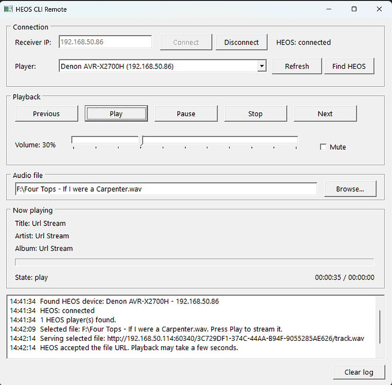  
  
- The complete HEOS Remote application adds playlist editing, file streaming, playlist streaming and Windows audio (loopback) streaming.
Its controls and form layouts are included for editing in the Delphi IDE.

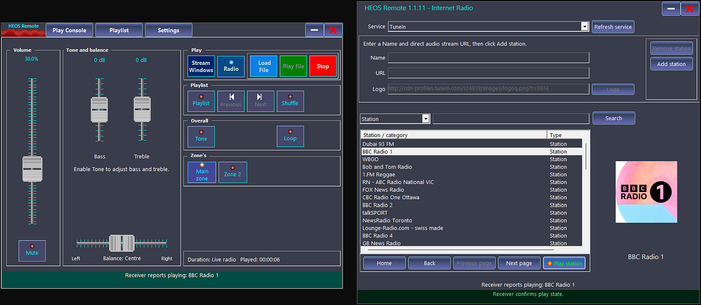
    
---
  
# Tools
  
**HResult Lookup Tool Application**
  
This tool can be used to determine HResult or Error codes returned by the Windows OS,  
featuring a detailed build in "HResult Lookup tool", the "Windows System Error Code Lookup Tool" and  
the "System.SysUtils.SysErrorMessage" function, that provides the localized translation (language of your OS) of the HResult.  
  
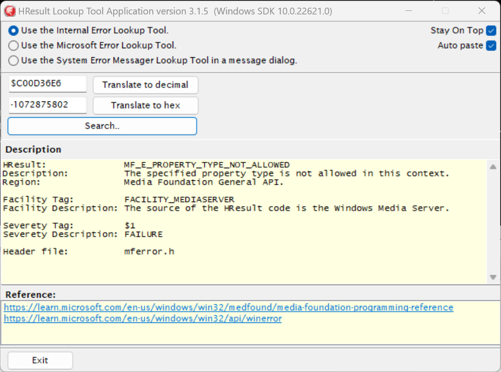
  
  
**Copyright © FactoryX. All rights reserved.**
