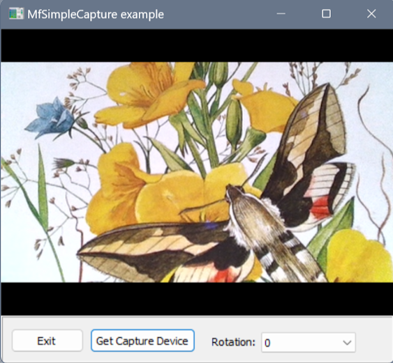
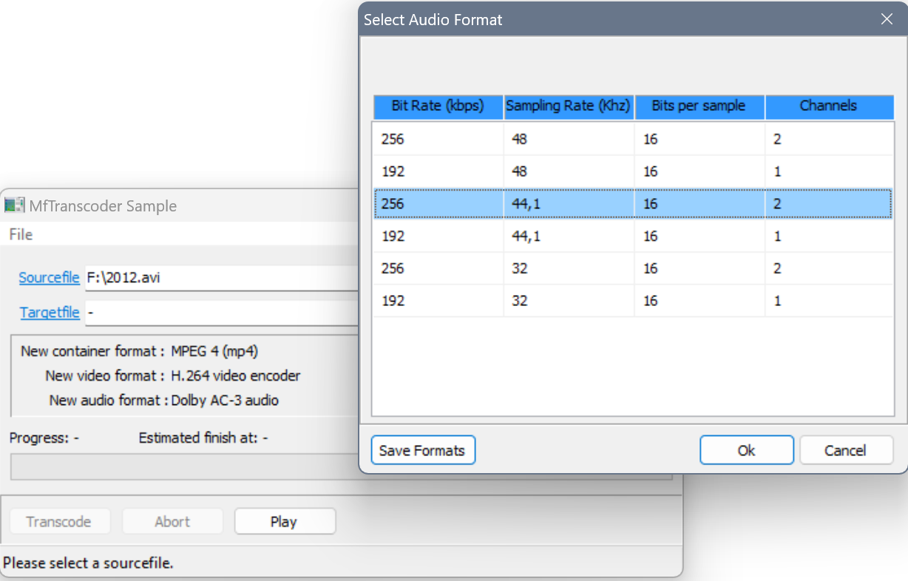
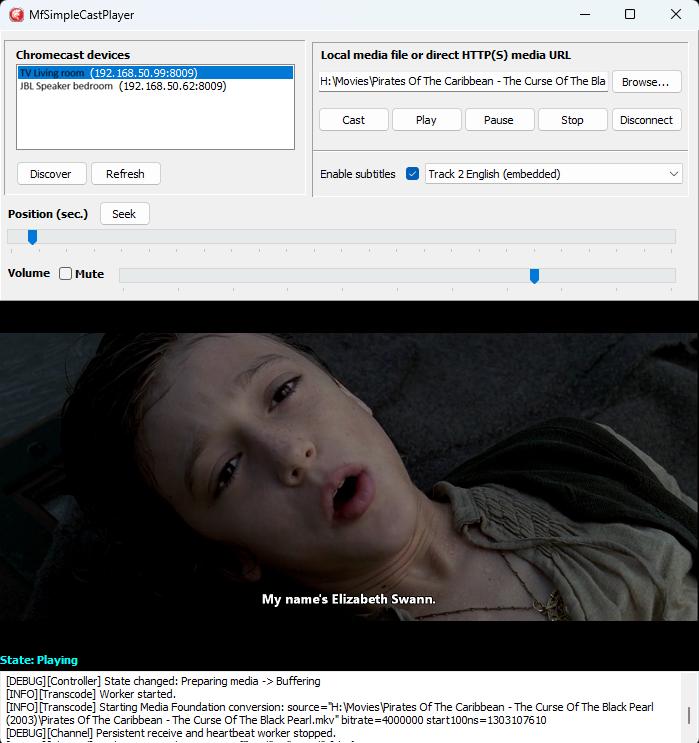
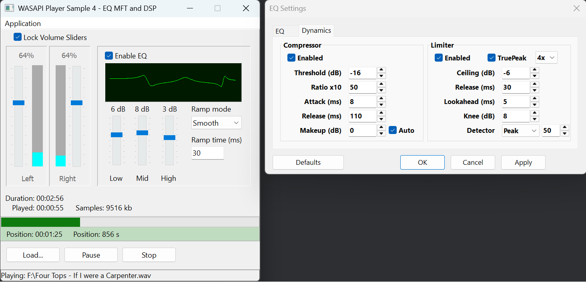

# About MfPack
  
 Delphi to Free Pascal port for Microsoft Media Foundation and related API's.
  
# MfPack covers the following API's:
  
- Core Audio API's:
  * Windows Audio Session API (WASAPI) 
  * DeviceTopology API
  * EndpointVolume API
  * Multimedia Device (MMDevice) API
- Microsoft Media Foundation API (successor of DirectShow).
- XAudio2 API (XBox game development, successor of DirectSound).
- Microsoft DirectX API's (D2D1, D3D9, D3D11, D3D12, DirectComposition, DXGI,  
  DirectWrite and DXVA) Note that D3D11 and above are part of Media Foundation.
- Windows Imaging Component (WIC) API.
- MPEG2 API.
- The complete Windows Media (WinMM) API.
  
# MfPack API's and Samples
  
- MfPack Cast V2.2 API.
- MfPack FxServe V1.1 API.
- Media Foundation, WASAPI, XAudio2 and streaming samples.
  
  
# <u>Latest release:</u> 
  
# MfPack Version 4.1.0  
FPC/Lazarus version 3.2.2 (64 bit)
SDK version: 10.0.28000.2705 (Windows 11).  
  
  
  
**Important note:**  
The latest Windows 11 versions do not support Dolby AC-3 and H.265 (hvec) encoders.  
Those you can buy from Microsoft Store or download elsewhere.
  
  
---
  
# Updates and porting status
### The porting of the complete MfPack Windows API sources (src) and Tools has been completed.  
### Porting the samples, Cast, and FxServe are still in progress, these and updates will be published as soon as possible.
  
---
  
# Samples
  
  
**AudioClip sample**
  
Demonstrates using the IMFSourceReader API to extract uncompressed media data from  
a media file. This sample application reads audio data from a media file and writes  
the uncompressed audio to a WAVE file.
  

---  
**SimpleVolumeControl sample**
  
This example shows how to use the MfAudioEndPoint component.  
Note that the maximum value of the maximum static DB values () are arbitrary!  
Please, install the '..\Samples\Components' first before loading this project.
  
---
**MfPlayer samples**

The player samples are based on the original Microsoft CPlayer sample.  
There are 4 samples in 4 project degrees.  
  
- *MfPlayer I : The basic player sample.*
- *MfPlayer II : The extended version I sample.*
- *MfPlayer X : This is an example that shows how to use the IMFTimer, language tags,*  
  *subtitles (SubRip, MicroDvd and WebVTT), RegEx (Regular Expressions) and how to get media properties.*
- *MfPlayer X2 : This example is based on the MfPlayer X project, but replaces the floating*
  *subtitle overlay with a real video-frame subtitle pipeline.*
  *Subtitles are now injected into the decoded video for local playback.*
  *Added MP4 export and Chromecast/Android TV/Google TV streaming support.*
  *The Player also demonstrates how Media Foundation playback, timed text,*
  *MFT processing, Source Reader/Sink Writer transcoding, IMFByteStream,*
  *mDNS, TLS, MfPack Cast V2 messages, and a local HTTP server can work together*
  *inside a Delphi application, without using 3th party components.*
  

---
**MfSimpleCapture Sample**

This example shows, how you have to implement capturing within a session.  
Note: The old MS sample used the deprecated IMFplayer interface. 
  

---
**MfTransode samples**
  
Demonstrates using the transcode API to transcode a source file (audio or video) to  
a different format (audio or video) supported by Media Foundation.  
  
Supported, but not limited, formats in this sample are:
  
- Audio
   * Waveform Audio File Format (wav)
   * MPEG Audio Layer III (mp3)
   * Free Lossless Audio Codec (flac)
   * MPEG-4 Audio (m4a)
   * Windows Media Audio (wma)
  
- Video
   * Audio Video Interleave (avi)
   * MPEG-4 Video with AAC Audio (mp4)
   * MPEG-4 Video with Dolby AC-3 Audio (mp4) 
   * Windows Media Video (wmv)

---
**MfWebCamStreamer Sample**
  
This sample is the extended version of MfSimpleWebCamStreamer, that uses FxServe to  
stream over the internet. Within the browser or installable PWA,  
users can watch the video and are able to take snapshots or record the camera stream. 
Note: The PWA operates like an app, that can be installed via the Install button in the browser.  
There is no need to get the PWA from any "Store".
  
The browser player includes:
  
- A live elapsed timer;
- PNG snapshots of the current camera frame;
- Client-side recording through `MediaRecorder` (downloaded as WebM);
- Live viewer count with privacy-masked IP addresses;
- Sound, playback, reconnect, and live-edge controls.
  

---
**MfComponents Samples**

This package contains the following -installable- components:  
  
* TQTimer - Queue Timer component. For precise timing.
* MfPeakMeter - Simple PeakMeter control.
* MfPeakMeterEx - Enhanged PeakMeter control.
* MfPeakMeterMmcs - Derived from MfPeakMeterEx with MMCS support and direct feed from external sources.
* MfAudioEndPoint - Audio EndPoint component that responds to volume changes.
  Uses: IAudioEndpointVolumeEx, IAudioEndpointVolumeCallback and IMMDeviceEnumerator.
* TThreadedQTimer - A threaded queue timer (experimental)
* MfAudioVisualizer - A visual component that uses WASAPI loopback, Peak/RMS, optional spectrum bars or VU.
* MfAudioVisualizerEx - Extended MfAudioVisualizer with MMCS support.
  
# WASAPI player / dsp / mft components:
  
* MfWasApiPlayerEngineComponent - WasApi renderer component supporting the MfWasApiEffectsRack and effects.
* MfParametricEqComponent - Parametric equalizer component.
* MfFlangerEchoComponent - Flanger / Echo component.
* MfCompressorLimiterComponent - Compressor / Limiter component.
* MfPitchTempoComponent - Pitching / tempo component.
* MfChorusComponent - Chorus component.
* MfWasApiEffectsRack - Effects rack component that controls FX DSP's and MFT's.
  
Note: On how to use these components, please read the WasApiPlayer sample 5 documentation.
  
# Other files/ helpers for the components.
* PcmLib.pas - A very convenient unit that is capable of recoding diverse WAV formats.
* WASAPIEngine.pas - Universal WASAPIEngine .
    
---
**MfSimpleCastPlayer Sample**
  
**This sample demonstrates:**
  
- Asynchronous Chromecast discovery.
- Device selection.
- Casting a compatible local file through a built-in HTTP server.
- Casting a directly reachable HTTP/HTTPS media URL.
- Play, pause, stop, seek, volume, mute, and disconnect.
- External subtitle files and embedded text-subtitle enumeration. External subtitle  
  files are preferred when the same language exists in both sources.
- Exact embedded-track selection and subtitle switching while casting.
  
The sample enables the optional Media Foundation conversion stack. Compatible  
MP4/H.264/AAC, WebM, MP3, M4A, and AAC sources use direct play. Containers such  
as MKV are converted to fragmented MP4 and published by the build-in HTTP server.  
Please read the white paper document MfPack/Cast/MfPack_Chromecast_API_White_Paper.txt for  
full details using the MfPack Cast API.  
  

  
---

## WASAPI Player samples
  
**Player Sample 1**
  
This sample demonstrates how to use the IAudioClient to render different  
audio formats like WAV, FLAC, MP3 etc.  
using the IMFSourceReader to decode the format suitable for playing in  
's IAudioClient and renderer.  
  
The sample plays formats like WAV (pcm and floatingpoint), MP3 and FLAC.  
It shows you the basics of using the IAudioClient, iAudioRenderer,  
IAudioClock and IAudioStreamVolume interfaces.  
The sample uses the MfPeakMeter component. This requires that you install the MfComponents.  
In your projectsettings you have to add ..MfPack\Samples\MfComponents in the project options searchpath.  
  

  
---
  
**Player Sample 2**
  
This sample is based on Sample 1, but includes full threaded code,  
using threadsafe events and also uses a custom MFT for bass and treble control.  
  

  
---
  
**Player Sample 3**
  
This sample is based on Sample 2, instead of a bass/treble MFT, this one is equiped with  
a 3 band High, Mid(Peaking or Notch) and Low EQ MFT and a spectrum analizer.  
It also stores and read back settings for the MFT.  
  

  
---
  
**Player Sample 4**
  
This sample demonstrates a **real-time audio playback engine on Windows** using:
  
- **** (event-driven, shared mode).
- **Media Foundation SourceReader**.
- A custom **3-band EQ** implemented as an **IMFTransform (MFT)**.
- A **Compressor / Limiter DSP**.
- Thread-safe **GUI and engine** command routing.
- The EQ settings are stored in an **INI file**.
  
## Features
  
- Glitch-free real-time playback.
- Low / Mid / High EQ with live control.
- Mid band supports **Peaking** or **Notch** mode.
- Adjustable **Q (bandwidth)** and shelf slopes.
- Settings dialog with persistent storage.
- Compressor / Limiter DSP with live control from the settings menu.
  
**Note:**  
This is not a sample for absolute beginners. Please read the documents included with this sample.  
  

  
---
  
** Player Sample 5**
  
This is a non-visual components application sample using .  
The sample shows you how to build a real-time audio playback engine for  
Windows using Delphi style components.  
  
## Features  
This sample also demonstrates how to create and implement a:
  
- Compressor/Limiter component using a MFT.
- Parametric Equalizer component using a MFT.
- Flanger/Echo component using a MFT.
- WASAPI effects rack that connects al MFT components to the WASAPI renderer.
- PlayerEngine component, using a WASAPI renderer.
  
**Note:**  
This is not a sample for absolute beginners.  
Please read the documents included with this sample.  
  

  
---

  
# Tools
  
**HResult Lookup Tool Application**
  
This tool can be used to determine HResult or Error codes returned by the Windows OS,  
featuring a detailed build in "HResult Lookup tool", the "Windows System Error Code Lookup Tool" and  
the "System.SysUtils.SysErrorMessage" function, that provides the localized translation (language of your OS) of the HResult.  
  

  
  
**Copyright © FactoryX. All rights reserved.**
